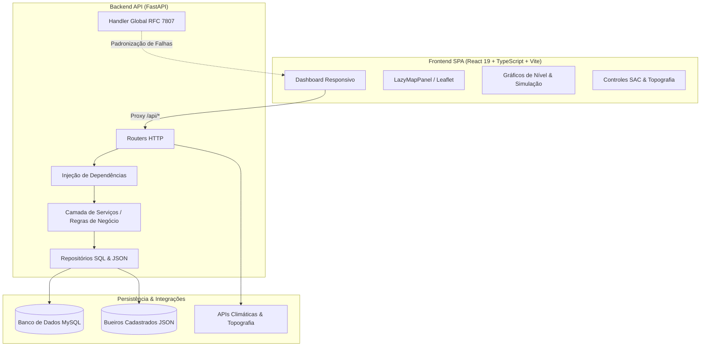

# Documentação de Adições e Migração: Web Responsivo e Refatoração da API

Este documento detalha o conjunto de melhorias, refatorações arquiteturais e novas implementações introduzidas no projeto **Smart Drain IoT**, compreendendo a substituição do dashboard legador em Streamlit por uma aplicação Web moderna em React/Vite, a estruturação em camadas do backend FastAPI e o saneamento das dependências em `requirements.txt`.

---

## 1. Visão Geral das Mudanças



---

## 2. Frontend: Migração de Streamlit para Web Responsivo (React + Vite)

### 2.1. Desativação do Streamlit
O antigo dashboard monolítico em Streamlit (`bueiro_inteligente_api/dashboard.py` — ~865 linhas) foi completamente removido do ecossistema ativo. Ele apresentava limitações de:
- Recarregamento total da página a cada interação do usuário;
- Alto acoplamento e consumo excessivo de memória;
- Dificuldade de responsividade precisa em dispositivos móveis e desktops.

### 2.2. Nova Arquitetura SPA (`bueiro_inteligente_api/frontend/`)
A nova interface foi construída em **React 19**, **TypeScript** e **Vite**, localizada em `bueiro_inteligente_api/frontend`:

- **Componentização Modular:**
  - `src/Dashboard.tsx`: Visão geral com 5 indicadores de topo, cards de monitoramento, simulador de risco em tempo real e status de limpeza.
  - `src/components/MapPanel.tsx` e `LazyMapPanel.tsx`: Mapeamento interativo de bueiros e chamados SAC com **Leaflet / OpenStreetMap**, carregado sob demanda (*lazy loading*).
  - `src/components/LocationControls.tsx`: Seleção de bueiros, geolocalização e projeção de coordenadas UTM para latitude/longitude.
  - `src/api.ts`: Cliente HTTP tipado consumindo a API FastAPI.
  - `src/types.ts`: Tipagem completa em TypeScript compartilhada com os contratos do backend.

- **Otimização de Pacotes e Code-Splitting:**
  - O bundle de produção foi particionado estrategicamente através do Rollup/Vite:
    - **Bundle principal (`index.js`):** ~265 kB (gzip: ~81 kB).
    - **Módulo de Mapeamento (`MapPanel.js`):** ~159 kB (gzip: ~47 kB).
    - **Módulo de Gráficos (`charting.js`):** ~402 kB (gzip: ~114 kB).
  - Garante carregamento instantâneo da visão geral sem aguardar o download de mapas pesados.

- **Qualidade de Código e Linting:**
  - Integrado o linter ultrarrápido `oxlint` (`.oxlintrc.json`), executando varredura estática com 0 erros e 0 warnings.

---

## 3. Backend: Arquitetura em Camadas e Segurança

O backend FastAPI foi refatorado para seguir princípios de arquitetura limpa, separação de responsabilidades e segurança:

### 3.1. Estrutura de Camadas
| Camada | Localização | Responsabilidade |
| :--- | :--- | :--- |
| **Routers** | `app/routers/` | Endpoints HTTP, validação de requisição, códigos de status e documentação OpenAPI. |
| **Dependencies** | `app/dependencies.py` | Injeção de dependências do FastAPI para repositórios e serviços. |
| **Services** | `app/services/` | Regras de negócio, cálculos e orquestração de transações. |
| **Repositories** | `app/repositories/` | Abstração de persistência (SQL via SQLAlchemy ou arquivos locais JSON). |
| **Schemas** | `app/schemas.py` | DTOs tipados com validação Pydantic v2. |
| **Errors** | `app/errors.py` | Tratamento centralizado de exceções e padronização RFC 7807. |

### 3.2. Tratamento Global de Exceções (RFC 7807)
Erros HTTP, falhas de validação de esquemas e exceções não tratadas agora retornam `application/problem+json`:
```json
{
  "type": "about:blank",
  "title": "Unprocessable Content",
  "status": 422,
  "detail": "Um ou mais campos sao invalidos.",
  "instance": "/bueiros/",
  "errors": [
    {
      "location": ["body", "latitude_montante"],
      "message": "Input should be less than or equal to 90",
      "code": "less_than_equal"
    }
  ]
}
```

### 3.3. Transações e Persistência Segura
- **`SQLAlchemyRecordRepository` / `RecordService`:** Operações de criação de registros (`alertas`, `limpeza`, `compactacao`, `historico`) utilizam sessões controladas. Se ocorrer falha no `commit`, é executado automaticamente um `rollback` para evitar inconsistências no MySQL.
- **Códigos de Status HTTP Padronizados:** Rotas de criação de registros passaram a retornar `201 Created` (em vez de `200 OK`).

### 3.4. Segurança de Credenciais
- Removidas credenciais padrão *hardcoded* (`root:1234`) de `app/database.py`.
- O banco agora requer obrigatoriamente a variável `DATABASE_URL` no ambiente ou no `.env`.
- Fornecido o modelo `bueiro_inteligente_api/.env.example`.

---

## 4. Saneamento do `requirements.txt` e Dependências Python

Na etapa de conferência final, foram solucionados os seguintes pontos críticos:

1. **Remoção de Fences Markdown e Correção de Whitespace:**
   - O arquivo continha acidentalmente marcadores de bloco markdown (` ```txt id="jlwm8m" ` e ` ``` `), além de quebras de linha irregulares.
   - Os marcadores foram removidos, e o arquivo foi padronizado, eliminando os avisos de whitespace do `git diff --check`.
2. **Inclusão Explícita das Dependências do Backend:**
   - Adicionadas as bibliotecas do servidor FastAPI que não constavam no arquivo raiz:
     - `fastapi>=0.115.0`
     - `uvicorn[standard]>=0.30.0`
     - `pydantic>=2.8.0`
     - `PyMySQL>=1.1.0`
3. **Indicação ao Frontend:**
   - Cabeçalho informando que as dependências do painel Web estão em `bueiro_inteligente_api/frontend/package.json`.

---

## 5. Como Executar o Projeto Atualizado

### 5.1. Inicializando o Backend (FastAPI)
```powershell
# A partir da pasta bueiro_inteligente_api
cd bueiro_inteligente_api
python -m uvicorn app.main:app --reload
```
- Swagger / Documentação OpenAPI: `http://127.0.0.1:8000/docs`
- Healthcheck: `http://127.0.0.1:8000/`

### 5.2. Inicializando o Frontend (React / Vite)
```powershell
# Em outro terminal, na pasta frontend
cd bueiro_inteligente_api/frontend
npm install
npm run dev
```
- O dashboard estará acessível em `http://localhost:5173`. As chamadas à API são automaticamente encaminhadas pelo proxy Vite para a porta 8000.

---

## 6. Procedimentos de Testes e Validação

### 6.1. Testes Unitários do Backend
Para rodar a suíte de 14 testes unitários isolados (sem necessidade de banco de dados ativo):
```powershell
$env:PYTHONPATH = "bueiro_inteligente_api"
python -m unittest bueiro_inteligente_api/tests/test_bueiros.py bueiro_inteligente_api/tests/test_api_errors.py bueiro_inteligente_api/tests/test_record_service.py
```
> **Status:** 14/14 testes aprovados (`OK`).

### 6.2. Lint e Build do Frontend
```powershell
npm --prefix bueiro_inteligente_api/frontend run lint
npm --prefix bueiro_inteligente_api/frontend run build
```
> **Status:** 0 erros de linting e build de produção gerado com sucesso.
