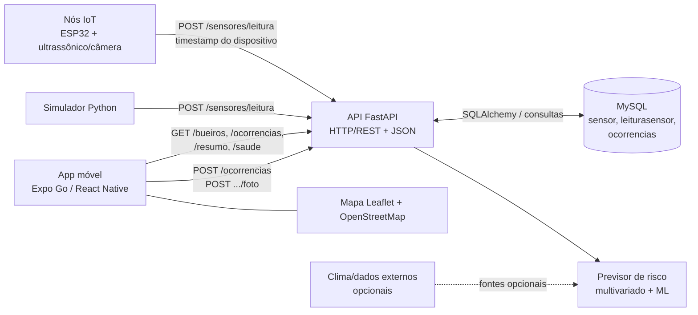

# Arquitetura distribuída do monitoramento de alagamentos

O app móvel consulta a API FastAPI por HTTP/REST e JSON. A API integra os dados
dos sensores, o banco MySQL e o previsor de risco já existente. O firmware ESP32
e o simulador enviam leituras para a mesma API. O app envia denúncias
georreferenciadas e consulta sensores, ocorrências e agregações para o resumo.

## Endpoints usados pelo app

| Método e rota | Uso |
|---|---|
| `GET /bueiros` | Posição, nível indicativo, status e última leitura. |
| `GET /bueiros/{id}` | Detalhe, leituras recentes e foto mais recente. |
| `GET /bueiros/{id}/previsao` | Previsão produzida pelo motor de IA existente. |
| `GET /ocorrencias` | Denúncias; aceita filtros `status` e `gravidade`. |
| `POST /ocorrencias` | Registra uma denúncia de alagamento. |
| `POST /ocorrencias/{id}/foto` | Anexa JPEG, PNG ou WebP de até 5 MB. |
| `PATCH /ocorrencias/{id}` | Atualiza o status da denúncia. |
| `GET /resumo` | Totais por status e gravidade. |
| `GET /saude` | Healthcheck consultado pelo app. |
| `POST /sensores/leitura` | Entrada de telemetria dos dispositivos e simulador. |

O Swagger em `/docs` publica as descrições e schemas desses endpoints. Fotos
enviadas ficam em `uploads/` e são servidas em `/uploads`. A API aceita leituras
com timestamp do dispositivo para reenvio idempotente.

## Limites e configuração

As coordenadas da migração principal são fictícias e ficam próximas ao centro
de São Paulo. O nível percentual do app é **indicativo**: o sensor mede
distância e a instalação precisa calibrar `BUEIRO_PROFUNDIDADE_CM` para a
profundidade física real. O mapa requer internet para os tiles; as denúncias
pendentes usam AsyncStorage no aparelho e o buffer de telemetria do firmware
fica somente em RAM. Fontes externas de clima e topografia são opcionais e
podem exigir configuração própria.
